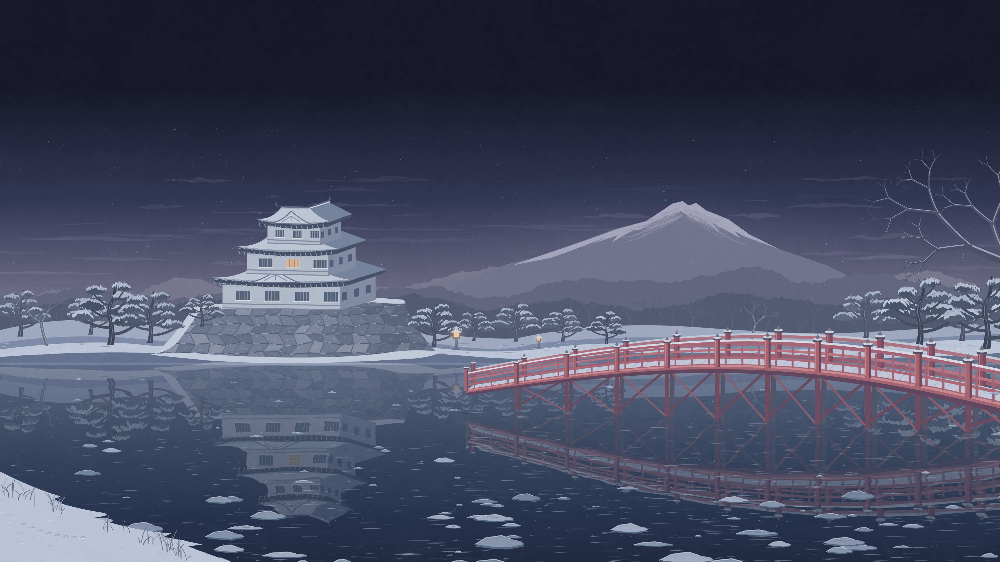

# Japan Night — Hirosaki Yukiakari

Snow blue, periwinkle and faded lacquer red in northern Japan. A dark companion theme for [Omarchy](https://omarchy.org/), part of the [Japan Night](https://github.com/devgtv/omarchy-japan-night-theme) collection.

[](backgrounds/hirosaki-yukiakari.jpg)

## Install

```bash
omarchy theme install https://github.com/devgtv/omarchy-japan-night-hirosaki-yukiakari-theme.git
```

Omarchy installs and applies the theme. To switch back to it later:

```bash
omarchy theme set japan-night-hirosaki-yukiakari
```

## Wallpaper and bar

Hirosaki Castle and a vermilion bridge reflected in a snow-framed winter moat. The original illustration is 3840 × 2160; its upper eighth is quiet, dark sky so a top bar does not obscure the main scene. `colors.toml` supplies the Omarchy palette and `waybar.css` defines matching foreground and background colours for Waybar setups.

The [editable SVG master](artwork/hirosaki-yukiakari.svgz) can be rendered at other resolutions. For example, with librsvg:

```bash
gzip -dc artwork/hirosaki-yukiakari.svgz | rsvg-convert -w 5120 -h 2880 > hirosaki-yukiakari.png
```

## More themes

See the [Japan Night collection](https://github.com/devgtv/omarchy-japan-night-theme#night-journeys) for the other Night Journeys variants.
